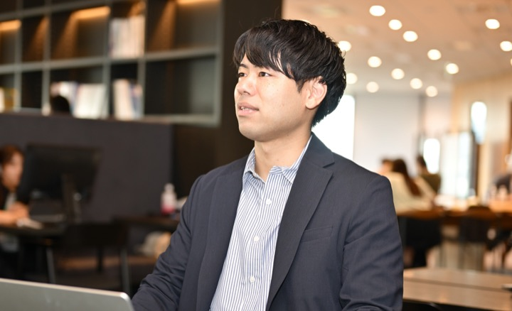
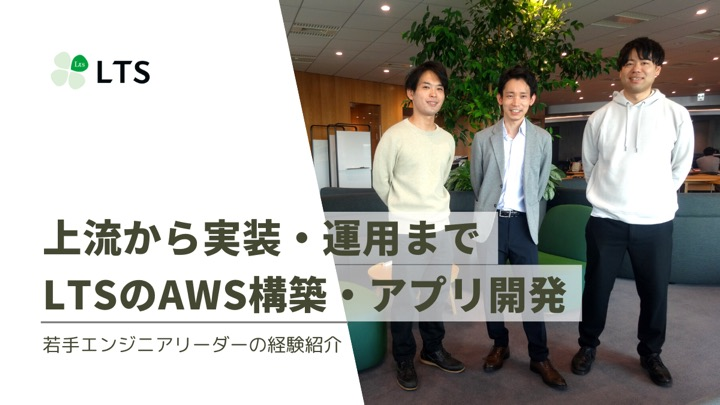
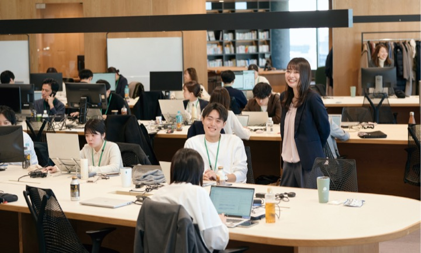
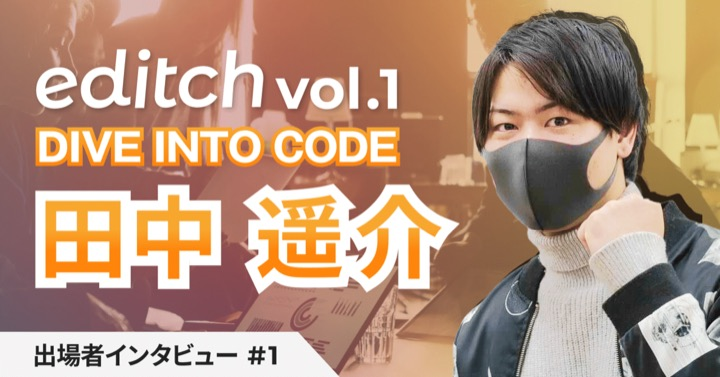

# Yosuke Tanaka — Tech Lead

I turn ambiguous requirements into working systems, connecting discovery, cloud architecture, application delivery, and production operations.

[日本語](README.md) · [Profile website](https://yodev21.github.io/yodev21/README.en.html)

## About {#about}

As a Tech Lead, I join projects while requirements are still taking shape and work with stakeholders through architecture, implementation, and operations. I work across cloud infrastructure and applications, staying hands-on wherever the product needs it.

Outside work, I have designed, built, and operated a novel and reading community since 2022. Running a long-lived service has given me practical experience beyond feature delivery, including incidents, cost, analytics, and continuous improvement.

## What Matters in My Work

  <section>
    01
    <h3>Structure ambiguity</h3>
    
I work with consultants and users to clarify loosely defined needs through dialogue and prototypes, then turn them into buildable decisions.

  </section>
  <section>
    02
    <h3>Connect product delivery</h3>
    
I lead across cloud architecture, infrastructure, application development, and production rollout so decisions become working software.

  </section>
  <section>
    03
    <h3>Increase team velocity</h3>
    
I design AI-assisted workflows, analytics, observability, and delivery foundations that help designers and growing engineers contribute.

  </section>

## Technologies I Work With Now

| Area | Technologies & themes |
|---|---|
| **AI × Product** | Vertex AI / Amazon Bedrock / Azure OpenAI / AI agents |
| **Cloud Native** | Google Cloud / AWS / Azure / Cloudflare |
| **Application** | Go / Python / TypeScript / Next.js |
| **Platform & Delivery** | Terraform / Docker / GitHub Actions / Observability |

[View all technologies used →](TECHNOLOGIES.en.md){: .text-link }

## Selected Work {#selected-work}

### AI Agent Proof of Concept

**Tech Lead · Python / Azure**

Leading the design and validation of an AI agent, from shaping requirements to implementation with real operational use in mind.

### Business Matching SaaS Launch

**Tech Lead · Google Cloud / Cloudflare / Vertex AI / Go / Next.js**

Leading across requirement discovery, cloud and application architecture, product development, and the operating model for launch.

### Novel & Reading Service Re-architecture

**Personal Product · Go / Next.js / Google Cloud / Terraform**

Redesigned a Rails service after four years in production, adding AI-assisted engineering, quality controls, analytics, and observability.

[View the personal project →](projects/personal/){: .text-link }

View complete professional experience

| # | Summary | Role | Key technologies |
|---|---------|------|------------------|
| 09 | AI agent proof of concept | Tech Lead | Python, Azure |
| 08 | Business matching SaaS launch and operating model | Tech Lead | Google Cloud, Cloudflare, Vertex AI, Go, Next.js |
| 07 | Cloud expansion and backend development | Infrastructure / Backend | Google Cloud, Go, Next.js |
| 06 | AI search proof of concept | Infrastructure / AI | Azure OpenAI, Functions, Django |
| 05 | Business SaaS platform and operations | Sub-lead / Infrastructure | Azure, Terraform, Django, Vue.js |
| 04 | Analytics platform operations | Lead / Platform operations | AWS, Python |
| 03 | Business system cloud platform | Infrastructure / CI/CD | AWS, Python, Vue.js |
| 02 | In-house web service development | Application / Infrastructure | AWS, Elasticsearch, Rails |
| 01 | On-premises business system delivery | Deployment SE / Operations | CentOS, Windows Server, Java, VB.NET |

## Leadership

### Go far, together

I focus on making the reasoning behind technical decisions visible so teams can act independently. While remaining hands-on, I bring designers and growing engineers into the process and close the gaps between requirements, architecture, and operations.

As AI accelerates implementation, tech leads need to decide what to build, where AI should contribute, and how quality will be assured. I work at that intersection of business, product, and engineering.

## Credentials & Writing

### Certifications

- Registered Product Owner — Scrum Inc. (2026)
- AWS Certified Solutions Architect – Associate
- AWS Certified Developer – Associate
- JDLA Deep Learning for GENERAL

### Interviews & Articles

  <a class="article-card" href="https://careers.lt-s.jp/students/interview/newgrad-bp-001002-1-1-0-0">
    
    <small>careers.lt-s.jp</small><strong class="article-card__title">“If you want to go far, go together” — a team-oriented engineering path</strong>On continuous learning and supporting each team member’s growth.
  </a>
  <a class="article-card" href="https://clover.lt-s.jp/9295">
    
    <small>clover.lt-s.jp</small><strong class="article-card__title">From discovery to delivery — AWS and application development at LTS</strong>How we work across upstream planning, implementation, and production operations.
  </a>
  <a class="article-card" href="https://good-companies.jp/2024/07/12/lt-s/">
    
    <small>good-companies.jp</small><strong class="article-card__title">Sharing a richer and more enjoyable working life at LTS</strong>An interview about work, career ownership, and growing with colleagues at LTS.
  </a>
  <a class="article-card" href="https://note.com/d_biz_share/n/n07cc2eac3b22">
    
    <small>note.com</small><strong class="article-card__title">editch interview #1</strong>Looking back on entering a portfolio competition and what changed afterward.
  </a>

## Connect

  
  
  
  
  
  

