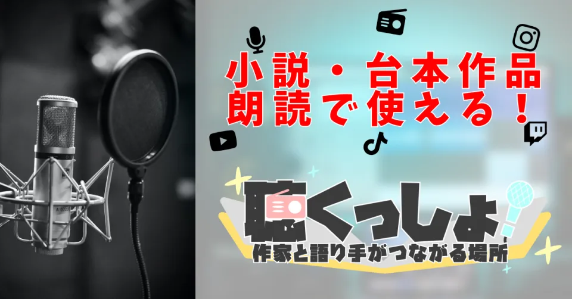

# 個人開発

<a class="product-card" href="https://kikusyo.com/" target="_blank" rel="noopener">
  
  

    
<strong>聴くっしょ！</strong><small>運営中</small>

    
作家が投稿した小説を、声優・ナレーターが許可を得て朗読できるプラットフォームです。2022年の公開から運営を続け、2026年4月にシステムを全面移行しました。

    
サービスを見る ↗

  

</a>

## プロジェクト一覧

| # | 案件名 | 期間 | 役割 | 主要技術 |
|---|--------|------|------|----------|
| 02 | [現行システムへのリアーキテクチャ](02_小説朗読投稿サービス_移行.md) | 2026年3月〜2026年4月 | 設計 / 開発 / インフラ / AI支援による開発 | Go, Next.js, Google Cloud, Terraform |
| 01 | [旧システムの開発・運用](01_小説朗読投稿サービス.md) | 2022年4月〜2026年3月 | 企画 / 設計 / 開発 / 運用 | Ruby on Rails, AWS Lightsail, MySQL |

## 使用技術の概要

<dl class="stack-summary">
  
<dt>クラウド</dt><dd>Google Cloud（Cloud Run / Cloud SQL / Cloud Storage / BigQuery / Vertex AI）、AWS Lightsail</dd>

  
<dt>言語</dt><dd>Go / Ruby / TypeScript</dd>

  
<dt>フレームワーク</dt><dd>Gin / Next.js / Rails</dd>

  
<dt>IaC・CI/CD</dt><dd>Terraform / GitHub Actions</dd>

  
<dt>データベース</dt><dd>PostgreSQL / MySQL</dd>

  
<dt>可観測性・分析</dt><dd>OpenTelemetry / Cloud Logging / Cloud Trace / BigQuery</dd>

  
<dt>その他</dt><dd>PWA / Firebase Cloud Messaging / Stripe / Amazon SES</dd>

</dl>
